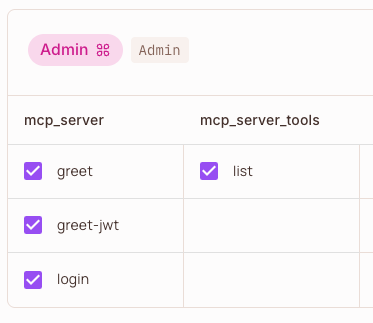
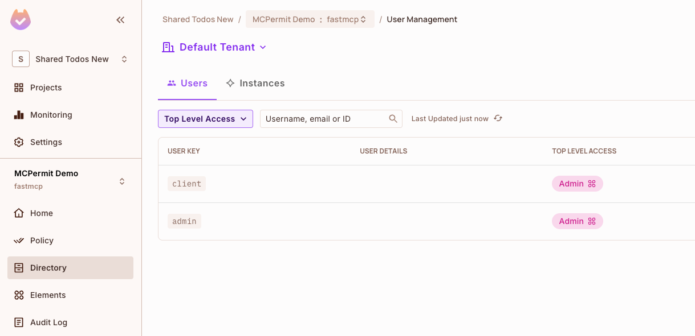
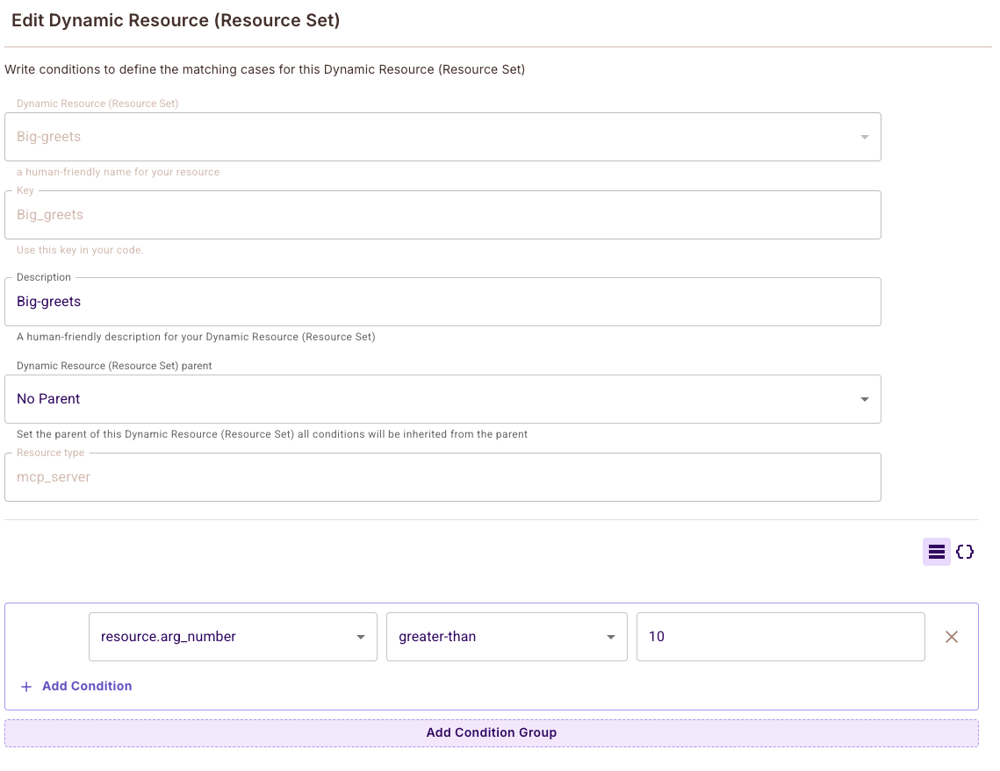
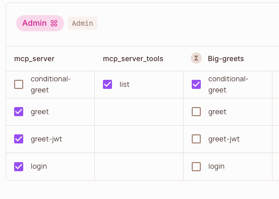

# Detailed Policy Mapping

This document explains how MCP methods and tool calls are mapped to Permit.io resources and actions by the `permit-fastmcp` middleware.

## Default Mapping

- **MCP server methods** (e.g., `tools/list`, `resources/read`):
  - **Resource**: `{server_name}_{component}` (e.g., `myserver_tools`)
  - **Action**: The method verb (e.g., `list`, `read`)
- **Tool execution** (method `tools/call`):
  - **Resource**: `{server_name}` (e.g., `myserver`)
  - **Action**: The tool name (e.g., `greet`)

## Visual Example



*Example: In Permit.io, the 'Admin' role is granted permissions on resources and actions as mapped by the middleware. For example, 'greet', 'greet-jwt', and 'login' are actions on the 'mcp_server' resource, and 'list' is an action on the 'mcp_server_tools' resource.*

> **Note:**
> Don’t forget to assign the relevant role (e.g., Admin, User) to the user authenticating to your MCP server (such as the user in the JWT) in the Permit.io Directory. Without the correct role assignment, users will not have access to the resources and actions you’ve configured in your policies.
>
> 
>
> *Example: In Permit.io Directory, both 'client' and 'admin' users are assigned the 'Admin' role, granting them the permissions defined in your policy mapping.*

## ABAC Policies with Tool Arguments

The `permit-fastmcp` middleware supports Attribute-Based Access Control (ABAC) policies that can evaluate tool arguments as attributes. When `PERMIT_MCP_FLATTEN_TOOL_ARGUMENTS=true` (default), tool arguments are flattened as individual attributes with the `arg_` prefix, allowing for granular policy conditions.

> **Note:** Relationship-Based Access Control (REBAC) policies are also fully supported by the middleware. REBAC examples and configuration guides will be added in future documentation updates.

### Creating Dynamic Resources with Tool Argument Conditions

You can create dynamic resources (resource sets) in Permit.io that match specific tool argument conditions. This allows you to define policies that only apply when certain argument values are met.

#### Example: Conditional Greeting Policy

Let's create a policy that only allows the `conditional-greet` tool when the `number` argument is greater than 10:

1. **Create a Dynamic Resource**: Create a new "Dynamic Resource (Resource Set)" named "Big-greets"
2. **Set Resource Type**: Use `mcp_server` as the resource type
3. **Define Conditions**: Add a condition that matches when `arg_number` is greater than 10



*Example: The "Big-greets" dynamic resource is configured with the condition `resource.arg_number greater-than 10`, which will only match tool calls where the number argument exceeds 10.*

### Policy Configuration

Once you have created your dynamic resource with conditions, you can configure policies that grant access only to that specific resource set:



*Example: The Admin role is granted access to the "conditional-greet" action on the "Big-greets" dynamic resource, while other tools like "greet", "greet-jwt", and "login" are granted on the base "mcp_server" resource.*

### Available Tool Argument Attributes

When tool argument flattening is enabled, the following attributes are available for ABAC policies:

- `arg_{parameter_name}`: Individual tool arguments (e.g., `arg_name`, `arg_number`, `arg_log_message`)
- `tool_name`: The name of the tool being called
- `mcp_method`: Always "tools/call" for tool executions

### Policy Examples

Here are some examples of ABAC policies you can create:

```python
# Allow conditional-greet only for admin users
{
    "user.role": "admin",
    "resource.type": "Big-greets",  # Dynamic resource with conditions
    "action": "conditional-greet"
}

# Allow conditional-greet only when name is "admin"
{
    "user.role": "user",
    "resource.type": "mcp_server",
    "action": "conditional-greet",
    "arg_name": "admin"
}

# Allow conditional-greet only when number is between 5 and 15
{
    "user.role": "user",
    "resource.type": "mcp_server", 
    "action": "conditional-greet",
    "arg_number": {"$gte": 5, "$lte": 15}
}
```

### Configuration

To enable tool argument flattening (enabled by default):

```env
PERMIT_MCP_FLATTEN_TOOL_ARGUMENTS=true
PERMIT_MCP_TOOL_ARGUMENT_PREFIX=arg_
```

For more configuration options, see [Configuration Reference](./configuration-reference.md#tool-argument-flattening).

## Customization

You can customize the mapping logic by changing the middleware settings (see [Advanced Configuration](./advanced-configuration.md)). 